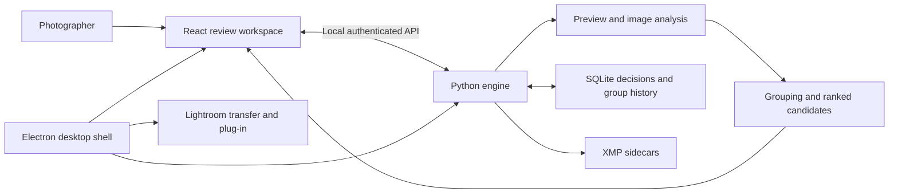

<p align="center"></p>
<h1 align="center">SnapSort</h1>
<p align="center">From a full shoot to a considered shortlist.</p>
<p align="center">Local photo culling · A university student engineering project</p>
<p align="center">
  <a href="https://github.com/Tharindu-akalanka/LensFlow/actions/workflows/snapsort.yml"></a>
  
  
</p>

**SnapSort helps photographers review similar frames, compare strong alternatives and carry their selections into editing.** Local image analysis suggests candidates; the photographer controls Keep/Reject decisions.

Created by **Tharindu Akalanka** as a university student project, with professional engineering practices as the goal: persistent data, recoverable workflows, regression tests, packaged execution and documented limitations.

**Explore:** [Development journey](docs/DEVELOPMENT_JOURNEY.md) · [Portfolio case study](docs/CASE_STUDY.md) · [User guide](docs/USER_GUIDE.md) · [Release notes](docs/releases/0.3.0-rc.2.md) · [Documentation](docs/README.md)

## The experience

**Create a shoot → Import → Prepare previews → Find similar moments → Review → Continue editing**

| Capability | What it does |
|---|---|
| Guided preparation | Explains stages, shows progress and supports recovery. |
| Similar-shot grouping | Combines capture context, visual evidence and geometric matching; preserves framing alternatives. |
| Quality assistance | Focus, eye and exposure hints plus a bounded offline aesthetic contribution. |
| Clear decisions | Green suggestions, yellow quality review, rejection reasons and separate multi-selection. |
| Close choices | Compares strong alternatives without treating tiny score differences as artistic certainty. |
| Correctable groups | Combine, move, merge, separate and split, with persistent overrides and independent undo. |
| Fast review | Space preview, keyboard decisions, multi-select, filmstrip and comparison views. |
| Editing handoff | XMP export and Lightroom Classic plug-in/transfer workflow; real Adobe qualification remains open. |

Analysis runs locally after model setup. Original image bytes are preserved. Optional XMP export writes sidecars beside originals; see the [user guide](docs/USER_GUIDE.md).

## Engineering behind the interface



**Stack:** Electron · React · TypeScript · Python · SQLite · OpenCV · MediaPipe · ONNX Runtime · Lua.

The repository retains its original **LensFlow** name and studio-management planning. SnapSort is the active desktop product. The NestJS/PostgreSQL starter is preserved separately; bookings, CRM and cloud services are not shipped SnapSort features.

## Evidence

Latest local qualification: **61 passing Python tests**, frontend lint/build, offscreen desktop workflow and frozen/packaged engine checks. These exercise persistence, grouping edits, undo, previewing, original-byte preservation and real RAW fixtures.

Read the [current validation record](docs/GROUP_REVIEW_UPDATE.md) for exact scope. CI can skip checks requiring locally provisioned models or camera fixtures; a green badge does not replace native-package checks. The [earlier qualification report](docs/VALIDATION_0.3.0.md) distinguishes measured Python coverage from UI and Adobe testing.

**Release candidate:** real Lightroom catalog testing, photographer-labelled accuracy, large-shoot performance, macOS, accessibility and distribution signing remain open. There is no claim of zero bugs or production certification.

## Run locally

Use Node.js 22.12+ and Python 3.13. Windows is the currently exercised desktop platform. From the repository root:

```powershell
python -m venv .venv
.\.venv\Scripts\Activate.ps1
python -m pip install -r local-engine/requirements.txt
python local-engine/setup_model.py
python -m pip install h5py onnx torch
python local-engine/setup_aesthetic_model.py
npm --prefix frontend ci
npm --prefix desktop ci
npm --prefix desktop run build:ui
npm --prefix desktop start
```

Setup downloads models; runtime analysis does not download them. Conversion dependencies are build-time requirements. For a portable Windows build, install PyInstaller in the active environment and run `npm --prefix desktop run build`. See the [maintainer handbook](docs/MAINTAINER_HANDBOOK.md) for configuration and troubleshooting.

## Repository map

| Path | Responsibility |
|---|---|
| [`frontend/`](frontend) | Review workspace and retained early UI scaffolds. |
| [`local-engine/`](local-engine) | Import, analysis, ranking, persistence, XMP and tests. |
| [`desktop/`](desktop) | Native shell, Lightroom bridge, packaging and verification. |
| [`docs/`](docs) | User/maintainer guides, journey and validation evidence. |
| [`project-management/`](project-management) | Requirements, process and historical plans. |
| [`backend/`](backend) | Separate historical NestJS/PostgreSQL starter. |

## Follow the development

The original setup commit remains in Git history. Much of the desktop product evolved locally before being committed; the [timeline](docs/DEVELOPMENT_JOURNEY.md) reconstructs milestones from project records, not invented backdated commits. Only verifiable source snapshots receive release tags.

See [contribution guidance](CONTRIBUTING.md), [agent handover](docs/AGENT_HANDOVER.md) and [security reporting](SECURITY.md). Third-party model notices live under `local-engine/models/`; no general open-source license grant is asserted for repository code.
