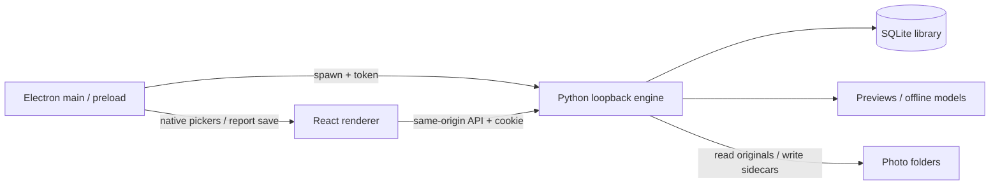

# SnapSort maintainer handbook

Desktop package version 0.3.0-rc.2, updated 2026-10-20. Read [group corrections and close-choice review](GROUP_REVIEW_UPDATE.md) and the 0.3.0 update below together with the historical baseline sections. Commands use PowerShell from the repository root unless stated otherwise. See [release qualification](VALIDATION_0.3.0.md) for earlier tested behavior and remaining gates.

## 0.3.0 guided workflow, moments, aesthetics and Lightroom

This section supersedes older statements that framing variants must always form separate groups, that no aesthetic model exists, or that exports are limited to XMP/JSON.

### Source ownership and user experience

`WorkflowGuide.tsx` / `.css` implement the collapsible next-step card and reusable help. Guide dismissal is a versioned localStorage preference. ProcessingStatus remains the real-progress preparation panel. Culling.tsx presents a fifth Lightroom step, close-call/variant controls, model availability hints and Refresh suggestions. `LightroomHandoff.tsx` owns setup/progress/recovery; see [integration protocol](LIGHTROOM_INTEGRATION.md) and [user guide](USER_GUIDE.md).

### Grouping and ranking

`grouping_features` adds at most 160 ORB descriptors/normalized point locations at a 640px maximum edge, with `grouping_version:2`. Older stored analyses lazily backfill these from their analysis preview, retaining user decisions. Existing conservative scene/framing matching runs first. Its alternative `same_moment` path requires nearby capture time (45s, or the existing filename fallback), bounded histogram distance, ratio-tested ORB correspondences, at least 12 geometric inliers from at least 14 matches, 60% inliers and spatial coverage in both frames. RANSAC homography tolerance is .015 in normalized coordinates. Matches compare group anchors, not unbounded chains. A bounded 2048-entry LRU avoids repeated geometric work. This is visual overlap, not GPS or person identification.

Each group exposes `variants: [{framing,suggested}]`, `close_call`, and `review_reasons`; photos expose `framing` and `framing_hints`. Face-area thresholds .075/.018 distinguish Close-up/Medium/Wide; missing faces use Scene. Assisted picks and automated target=0 include each framing winner. Fixed targets still use quality tiers and timeline coverage. Scene-only frames are not given invented body-pose labels.

Measured preview/face sharpness now saturates at log score 6, with face sharpness weighted .65. Smile intensity no longer earns a ranking bonus. A face close to a crop edge adds a small review hint/penalty; this is not a full body/joint detector. Existing analyses use the same derived rank calculation when fields are present.

`aesthetic_runtime.py` runs an offline AVA-trained idealo NIMA MobileNet in Balanced/Detailed. It returns a mean aesthetic rating and distribution spread, not a calibrated confidence percentage. The ranking contribution is .3*(mean-5), clipped to ±.6; explicit quality tiers/penalties remain stronger. Fast skips it. Missing/failed model inference degrades to quality hints and a visible availability message. The model cannot explain specific pose, gaze, headroom or storytelling preferences; do not invent those explanations from its scalar output.

The 12,967,792-byte ONNX is converted by `setup_aesthetic_model.py` from pinned Apache-2.0 idealo weights. Original Keras 2.1.6 symmetric padding, batch-normalization epsilon .001, MobileNet depthwise topology, 224-square RGB [-1,1] preprocessing, pooling and softmax are preserved. Build-only h5py/onnx/torch are not runtime requirements. Conversion compares three inputs against independent PyTorch tensor operations (maximum absolute error under 2e-6). Provenance/checksums and the complete publisher license ship with the app. This checks conversion correctness, not portrait-selection accuracy.

### API and persistence additions

`POST /api/sessions/{id}/reanalyze` with `{}` resets analysis in the current mode and starts processing; Keep/Reject, reasons and ratings survive. Running-project protections still apply. Existing projects need Refresh suggestions for new aesthetic assessment; descriptor backfill alone does not run an unannounced model job.

Photos return `analysis.aesthetics` with status available/unavailable/skipped_in_fast_mode, optional score/spread/model. Embeddings, local ORB descriptors and point arrays stay out of renderer snapshots. No new SQLite columns are required by this version. Export Selection Report schema 2 includes photo IDs, preferences, group memberships, variants and suggestions for reproducible evaluation.

### Maintenance and qualification

Run Python regressions, Node transfer tests, Lua SDK-contract tests, renderer lint/build, `verify-workflow.cjs`, frozen verification and packaged verification. `.github/workflows/snapsort.yml` adds a dedicated Windows job; absent optional model/RAW fixtures are skips rather than successful inference evidence. This workflow has been added but has not been run remotely in this change.

`evaluate_selection.py` compares an exported report with photographer-labelled moments/acceptable picks; it reports pairwise grouping precision/recall and within-labelled-moment top-1/top-2 hit rates. Keep tuning and held-out shoots separate. The evaluator never edits a library or reads originals. See [accuracy guide](ACCURACY_GUIDE.md).

The current build is a release candidate. Real Lightroom catalog execution and supported-version/platform qualification must precede stable distribution. Large-shoot latency/memory and pose/expression accuracy require separate measurements. Numerical model checks and code coverage are not substitutes for those evaluations.

## Contents

- [Product and scope](#product-and-scope)
- [Setup](#setup)
- [Architecture and source map](#architecture-and-source-map)
- [Processing and AI rules](#processing-and-ai-rules)
- [API reference](#api-reference)
- [Data model and recovery](#data-model-and-recovery)
- [User workflow](#user-workflow)
- [Testing and packaging](#testing-and-packaging)
- [Maintenance recipes](#maintenance-recipes)
- [Troubleshooting and limitations](#troubleshooting-and-limitations)

## Product and scope

SnapSort is the active local Electron photo-culling application. It imports JPEG/MPO, HEIC/HEIF and supported camera RAW previews, produces quality and face hints, groups similar photos, recommends candidates, retains human decisions/stars/colors, watches shoot folders, and exports JSON reports/XMP sidecars. Runtime photo processing is offline.

NestJS/PostgreSQL in `backend` is a separate LensFlow scaffold. Authentication, bookings, payments, cloud storage, CRM, client widgets and multi-user workflows in older documents are not implemented active SnapSort features. The frontend currently mounts Culling directly, without Login/Dashboard routing. Bulk copying selected originals is not implemented. Exporting metadata does not establish an editor round-trip guarantee.

## Setup

### Environment

Use Windows for Windows packaging, Git, Node/npm and Python. During this documentation pass the installed versions were Node 24.18.0 and Python 3.13.13; these are observed versions, not a qualified minimum support matrix. Python native dependency availability must be verified on other versions/platforms. Docker is needed only for the optional NestJS scaffold.

There is no root npm package; each component has its own lockfile. Use `npm ci` for reproducibility. Initial dependency/model downloads require internet; runtime does not download models.

### Desktop development

```powershell
python -m venv .venv
.\.venv\Scripts\python.exe -m pip install -r local-engine/requirements.txt
.\.venv\Scripts\python.exe -m pip install pyinstaller
$env:LENSFLOW_PYTHON = (Resolve-Path .\.venv\Scripts\python.exe).Path
$env:Path = "$(Resolve-Path .\.venv\Scripts);$env:Path"
npm --prefix frontend ci
npm --prefix desktop ci
python local-engine/setup_model.py
npm --prefix desktop run build:ui
npm --prefix desktop start
```

Keep `.venv` out of commits. The PATH adjustment matters: asset preparation invokes literal `python`; the engine launcher/freezer honors `LENSFLOW_PYTHON`. Electron loads built `frontend/dist`, not the Vite server. Rebuild UI before desktop checks following renderer changes.

Model setup downloads `face_landmarker.task`, `squeezenet1.1-7.onnx`, provenance JSON and visual-model license. SqueezeNet is checked against a fixed SHA-256; the face model URL uses `latest`, and setup records its digest without comparing against a pinned expected digest. Preserve source metadata/license in releases. Models are ignored build inputs; a clean clone needs setup.

### Browser iteration

Terminal 1:

```powershell
python local-engine/server.py --data local-engine/.local-data/dev-library
```

Terminal 2:

```powershell
npm --prefix frontend run dev
```

Engine default is `127.0.0.1:8765`. Vite binds loopback and proxies `/api` to that engine; use the URL Vite prints, normally port 5173. Native pickers need Electron; browser development uses the local path workflow. A different engine port requires a proxy update. Do not expose the tokenless development server to the network.

### Configuration

| Setting | Consumer / effect |
|---|---|
| `LENSFLOW_PYTHON` | Development desktop launcher/PyInstaller; defaults to `python`. Packaged app uses bundled executable. |
| `LENSFLOW_DATA_DIR` | Desktop library override; default Electron `userData/library`. Set a separate path for verification. |
| `LENSFLOW_ENGINE_TOKEN` | Optional engine authentication; desktop generates a random value on launch. Do not hardcode/log it. |
| `--data` | Standalone engine defaults to `local-engine/.local-data`. |
| `--model` | Face model path; visual model is expected in the same directory. |
| `--port` | Standalone 8765; desktop uses 0 for an ephemeral available port. |
| `--frontend` | Built UI directory, default `frontend/dist`. |
| `--migrate` | Legacy source library to copy into a fresh target. |
| `VITE_API_URL` | Retained Axios NestJS client only, not active localEngine service. |
| `PORT`, `DATABASE_URL` | NestJS port and PostgreSQL URL. |
| `JWT_SECRET`, `JWT_REFRESH_SECRET` | Example settings; no registered auth module currently consumes them. |
| `NODE_ENV` | Node runtime environment convention. |

### Optional LensFlow backend

```powershell
docker compose up -d postgres
if (!(Test-Path backend/.env)) { Copy-Item backend/.env.example backend/.env }
npm --prefix backend ci
Push-Location backend
npx prisma generate
npx prisma migrate dev --name init
npm run start:dev
Pop-Location
```

Compose uses PostgreSQL 16, port 5432, `lensflow_dev`, `lensflow`, development sample credentials, and persistent `postgres_data` volume. Never overwrite existing `.env` files or publish their values. Replace sample secrets for any non-development use. `docker compose stop postgres` preserves the volume; deleting the volume removes the database.

NestJS has a global `/api` prefix, validation pipe and Swagger at `/api/docs`. `GET /api` returns the starter greeting. Prisma uses `prisma.config.ts` and a PostgreSQL adapter/connection pool. The schema currently contains only User and Role. No migration directory appears in the reviewed tree; initial migration creation is separate from CI `migrate deploy`. Review/commit actual migrations when extending that component.

## Architecture and source map



Electron acquires a single-instance lock, spawns Python or the frozen executable, waits up to 90 seconds for the printed engine URL, sets an HttpOnly cookie and loads the served UI. A second launch reveals the existing window. Shutdown uses the authenticated API, then a limited wait and process termination fallback. Startup converts interrupted work to paused.

The renderer refreshes library/project/health every two seconds. There is one active import/culling worker across projects; preview preparation uses two threads. Pause completes in-flight work cooperatively. Folder watching and metadata writes have background threads. Store connections are per operation, transactional, with SQLite WAL and foreign keys.

| Source | Ownership |
|---|---|
| `frontend/src/App.tsx`, `main.tsx` | Active root mount. |
| `frontend/src/pages/Culling.tsx` | Library/import, polling/actions, filters, review/keyboard state, report export. |
| `frontend/src/components/AdvancedCulling.tsx` | Automated target, metadata, watch/XMP controls. |
| `frontend/src/components/Survey.tsx`, `SyncPreview.tsx` | Multi-photo review and linked previews. |
| `frontend/src/services/localEngine.ts` | API transport, response types, photo URL helper. |
| `frontend/src/types/desktop.d.ts` | Desktop bridge type declarations. |
| `Culling.css`, `Culling.motion.css`, `index.css` under frontend/src | Layout, motion, global styles. |
| `desktop/main.cjs`, `preload.cjs` | Lifecycle, security, authorized IPC and exposed bridge. |
| `desktop/scripts/prepare_assets.py` | Branding/build assets. |
| `desktop/scripts/build-engine.cjs`, `verify-engine.cjs` | Python freezing and frozen integration validation. |
| `local-engine/server.py` | HTTP, orchestration, migration and shutdown. |
| `local-engine/store.py` | SQLite schema, input validation, persistence, snapshots, undo. |
| `local-engine/import_photos.py`, `photo_io.py` | Metadata, cached preview extraction, deferred full render. |
| `local-engine/analysis.py`, `vision_runtime.py` | Quality/faces, grouping and offline descriptors. |
| `local-engine/selection.py` | Automated recommendations. |
| `local-engine/watching.py` | Stable local folder ingestion. |
| `local-engine/xmp.py`, `metadata_sync.py` | Sidecar read/merge/backup and queued writes. |
| `local-engine/setup_model.py` | One-time model download/provenance. |
| `local-engine/test_*.py` | Import/store/culling/advanced regressions. |
| `backend/src`, `backend/prisma` | Retained NestJS scaffold, separate from active runtime. |

### Security invariants

Engine binds only `127.0.0.1`. Host must be localhost/127.0.0.1; provided Origin must match allowed engine/Vite origins. If configured, token comparison is constant-time using cookie or bearer header. POST requires JSON, an object body and length <=10 MiB. Static files enforce frontend-directory containment; photo routes resolve stored IDs rather than caller-supplied arbitrary paths.

Electron disables Node integration, enables context isolation and sandboxing, denies permission requests/new windows, blocks navigation off origin, and checks IPC sender frame/origin. Report save validates JSON and limits the string to 50 MiB. Keep these boundaries when extending IPC. Local storage is not encrypted and this is not multi-user authorization.

## Processing and AI rules

Imports validate a complete path list before insertion; folder scanning is immediate-files only, not recursive. Maximum 20,000 entries per import. Resolved casefolded source paths prevent duplicate imports within a project. This is path deduplication, not content deduplication across the library.

Supported extensions: `.jpg`, `.jpeg`, `.heic`, `.heif`, `.cr3`, `.cr2`, `.arw`, `.nef`, `.nrw`, `.raf`, `.rw2`, `.orf`, `.dng`, `.pef`, `.srw`. Decoder/embedded-preview compatibility still controls actual support. MPO inside JPG uses frame zero.

Cache key hashes source path, size, nanosecond mtime and pipeline version (currently 5). Thumbnails have a maximum 480px edge and analysis proxies 1600px. Import normalizes orientation and retains available ICC metadata. RAW import extracts a bounded embedded JPEG, avoiding sensor decode; unusable preview encodings fail explicitly. Full RAW inspection defers rawpy/LibRaw decoding, one render at a time, cached as `inspection.jpg`. JPEG inspection serves original bytes.

| Mode | Analysis edge | Face processing |
|---|---:|---|
| Fast | 640 | Skipped |
| Balanced | 1280 | Proxy faces |
| Detailed | 1600 | Higher-resolution JPEG/embedded-preview face crops |

Face detection caps at 20. Face indices are frame-local, not person identities. Blink coefficients >=0.65 yield possibly closed, <=0.25 likely open; remaining/poor observations are unknown. Quality scores mix log sharpness, face sharpness, exposure fractions, eye hints and expression. These are uncalibrated review hints, not probabilities or aesthetic ground truth.

Original-byte SHA-256 supports exact duplicates. SqueezeNet provides normalized ImageNet logits for conservative similarity. DirectML on Windows/CoreML on macOS are preferred when available; CPU fallback handles provider failure. Errors are recorded in analysis. Health checks file existence only, not successful model inference.

Grouping compares the first photo in a group to prevent long chains. Exact hashes group regardless of time. Other matches require capture time within three seconds, aspect ratio/hash or learned descriptor agreement, and histogram similarity. Missing times prevent speculative grouping. Suggestions and up to two alternatives leave decisions independent. Automated target selection spreads winners over chronological segments, excludes explicit rejects, and counts each checksum once. A target can remain unmet when unique eligible images are insufficient. Target 0 uses group winners.

Mode changes and face-option changes require paused work and invalidate analysis while preserving decisions/ratings/history. Grouping/alternative changes recompute views without quality reprocessing. Source size/mtime changes during analysis fail instead of attaching stale results.

## API reference

Base URL is the engine origin, not NestJS. All paths below include `/api`. GET returns JSON except photo images; POST uses `Content-Type: application/json`. Use `{}` for actions without fields. When token-protected, send the desktop cookie or `Authorization: Bearer <token>`.

| Method / path | Body or query | Response |
|---|---|---|
| GET `/api/health` | None | `{local, model_ready, visual_model_ready}` |
| GET `/api/sessions` | None | Library summary array. |
| GET `/api/sessions/{id}` | None | Full project snapshot. |
| GET `/api/photos/{id}/{kind}` | `kind`: thumbnail, analysis, embedded, original, face; face needs `?index=0` etc. | Image/jpeg or error. |
| POST `/api/sessions` | `{name, mode?}` or legacy `{folder, mode?}` | 201 `{id}`. |
| POST `/api/sessions/{id}/import` | `{files:[absolutePaths]}` or `{folder:absolutePath}` | `{added:number}`; preview job starts if added. |
| POST `/api/sessions/{id}/resume` | `{}` | `{ok:true}`; starts analysis, not preview generation. |
| POST `/api/sessions/{id}/pause` | `{}` | `{ok:true}`; poll until current work ends. |
| POST `/api/sessions/{id}/retry` | `{}` | `{ok:true}`; errors reset, pending previews prepared. |
| POST `/api/sessions/{id}/mode` | `{mode:"fast"|"balanced"|"detailed"}` | `{ok:true}` |
| POST `/api/sessions/{id}/options` | `{options:{grouping:boolean,faces:boolean,alternatives:boolean}}` | `{ok:true}` |
| POST `/api/sessions/{id}/preferences` | `{preferences:{workflow,target,avoid_blur,avoid_closed,avoid_exposure,auto_xmp}}` | `{ok:true}` |
| POST `/api/sessions/{id}/rating` | `{photo:id,rating:0..5,label:color}` | `{ok:true}` |
| POST `/api/sessions/{id}/decision` | `{photo:id,decision:"keep"|"reject"|"undecided"}` | `{ok:true}` |
| POST `/api/sessions/{id}/undo` | `{}` | `{ok:true}`; latest decision only. |
| POST `/api/sessions/{id}/watch` | `{watch:{enabled:boolean,folder:string,auto_cull:boolean}}` | `{ok:true}` |
| POST `/api/sessions/{id}/xmp` | `{}` | `{written,failed,errors:[{name,error}]}` |
| POST `/api/shutdown` | `{}`; available with server token | `{ok:true}`; shuts engine down. |

Project names are trimmed, nonempty and <=120 characters. Option/preference/watch objects require their complete exact key sets. Workflow is assisted/automated; integer target 0..20,000; all avoidance/auto flags are booleans. Rating is integer 0..5; labels are empty, Red, Yellow, Green, Blue or Purple. Enabled watch folder must exist. Photo mutations must refer to a photo in the given session.

Errors usually return `{error:string}`: 403 for local/auth/content-type rejection, 404 for unknown resources/actions and missing keys, 400 for validation/filesystem/type errors. Some unexpected exceptions are not globally converted to JSON. Active transport parses JSON and raises the server message; failed JSON parsing gives an engine-unavailable message. There is no implemented project delete/rename endpoint, bulk-copy export or auth API.

Snapshot includes session fields, photos, groups, options/preferences/watch, recommendations/count, can_undo, elapsed/error, xmp_error/watch_error, and counters:

- `total`: all imported records; `imported`: records with thumbnails.
- `analyzed`: ready records with analysis; `pending`: pending photo records.
- `completed`: snapshot ready + error records; library summaries count ready only.
- `failed`: error records; `import_errors`: errors without thumbnails; `preview_pending`: pending without thumbnails.

Groups contain id, photos, suggested ID/null, alternative IDs and explanation. Embeddings are persisted but stripped from renderer snapshots. Keep `frontend/src/services/localEngine.ts` aligned when changing response shapes.

## Data model and recovery

### Local SQLite

Default desktop root is `app.getPath('userData')/library` (typically under Windows roaming app data; resolve the actual app path rather than assuming its casing/name). Standalone default is `local-engine/.local-data`. `LENSFLOW_DATA_DIR` changes the desktop location. Originals are referenced by absolute source path and are not copied into the library.

| Table | Fields / behavior |
|---|---|
| sessions | id PK, name, folder, mode, status default paused, elapsed default 0, error, created timestamp; options/watch/preferences JSON text added by startup migration. |
| photos | id PK, session FK, source, name, status default pending, data JSON, analysis JSON, decision default undecided, error; rating default 0, label empty, metadata_touched false added by startup migration. |
| history | sequence integer autoincrement PK, session, photo, previous decision. Session-level latest decision undo; no star/color undo. |

Index `session_photos` accelerates session lookups. JSON preview records include source/preview paths, original dimensions/format/time and source revision metadata; analysis includes checksum/hints/faces/crop paths/descriptors. Groups/recommendations/counters are derived on snapshot, not separate tables. Snapshot option defaults are all true; preferences default assisted, target 0, avoidance true, auto_xmp false; watch defaults disabled, empty folder, auto_cull true.

Session states include paused, importing, previews_ready, running, pausing, complete, partial and failed. Photo states are pending, ready, error. Saved previews do not mark photos analyzed. One failed photo with successful analysis yields partial; all failed yields failed. Startup resets interrupted importing/running/pausing to paused and corrects historical complete sessions with errors.

### Backup and restore

1. Pause/disable watched processing, exit SnapSort and ensure its engine has stopped.
2. Copy the entire library directory, including `sessions.sqlite3`, any WAL/SHM files and `previews`, to a dated backup. Back up original photo folders/XMP separately; the library is not a photo backup.
3. Keep a restore copy of the application version and model provenance when changing schema/models.
4. Test restoration in an isolated `LENSFLOW_DATA_DIR` with a working copy. Preview records contain absolute cache paths: restoring at the same original root is simplest. Do not assume moving a copied library automatically rewrites paths.

For live SQLite database backup use SQLite's backup API; copying only the main database while WAL is active can omit recent writes. The reviewed recovery script does this API backup, but its retry assertions and input assumptions make it a targeted repair tool, not a generic backup command.

Startup legacy migration runs only when the target DB does not exist and the source DB does. Electron checks former LensFlow/lensflow-desktop app-data locations and, in development, the prototype `.local-data`. Python `--migrate` uses SQLite backup, copies previews and relocates cache paths in data/analysis JSON while retaining original/source paths. Test using copies before using migration to relocate a real library. It does not move original photos.

Store schema upgrades use `CREATE TABLE IF NOT EXISTS`, column inspection and additive ALTER TABLE. For a new migration, preserve defaults and old JSON compatibility; test both fresh and previous-version libraries. There is no numbered local migration registry/downgrade system. Restore backups for a failed incompatible upgrade.

### XMP semantics

Sidecars live beside originals with `.xmp` replacing the photo extension. Import reads supported stars/colors and SnapSort decision; rating -1 implies reject. Manual rating/label edits set metadata_touched and override automatic mapping. Untouched choices map Keep to 5/Green, Reject to -1/Red, recommendation to 4/Yellow. SnapSort decision/recommended fields are also written. A JSON report is not the persistence database and does not include every metadata preference/field.

Existing XML/editing fields are preserved semantically; serialization formatting may change. An initial `.xmp.snapsort-backup` is made once. Writes use same-directory temporary files, flush/fsync and atomic replace. Malformed/unsupported XML, missing originals, read-only paths and RAW/JPEG same-basename collisions report failures. Auto-save filters known collisions, coalesces by photo ID and writes asynchronously; errors surface in snapshots. Inspect failure counts even when HTTP succeeds. Originals are never modified, but enabled XMP export deliberately changes sidecars.

## User workflow

1. Open SnapSort and create a named project from the library.
2. Import files or one shoot folder using native pickers. Wait for progressive thumbnails/proxies; retry failed imports if necessary.
3. Choose Fast/Balanced/Detailed and face/grouping/alternative options. Start Culling after previews are prepared.
4. Pause when needed; wait for in-flight work to finish before changing mode/import settings. Resume saved pending work after reopening.
5. Review grid, Loupe, linked Compare or 4/9/16 Survey. Use filters/search/group candidates, face overlays/comparison and key-face inspection.
6. Keep/reject/undecide explicitly; optionally set stars/colors or use automated target recommendations. Recommendations do not replace decisions.
7. Save JSON report or export XMP. Enable auto-save only when sidecar writes beside originals are desired; verify target editor behavior.

| Shortcut | Action |
|---|---|
| K / R / U | Keep / reject / undecided |
| Left / Right | Previous / next visible photo |
| G / E / C | Grid / Loupe / Compare |
| 0 | Fit view |
| Space | Open/close Quick Preview; arrows browse and Escape closes |
| Ctrl/Cmd+Z | Latest decision undo |
| Ctrl/Cmd+N | New project |
| Escape | Close active modal |

Editing fields suppress review shortcuts. XMP stars/colors are persisted but not part of decision undo. RAW Loupe can show embedded preview before full inspection; Detailed face crops do not imply full sensor rendering.

Watched folders are local, nonrecursive tethering drop locations. Camera control stays in external tethering software. Polling every second requires unchanged size/mtime over successive scans (count >=2) before import, up to 20,000 detected files per batch. Pause blocks auto processing globally via the shared pause event; disabling watch stops future ingestion. Stable detection cannot prove an external writer has finished permanently. New work waits while another project is processing.

JSON report includes project name/mode/options and each photo name/decision/analysis; desktop uses native save, browser uses Blob download. It does not copy selected originals, encode all ratings/preferences, or replace a library backup.

## Testing and packaging

### Routine checks

```powershell
Push-Location local-engine
python -m unittest discover -v
Pop-Location
npm --prefix frontend run lint
npm --prefix frontend run build
```

Tests cover original-byte preservation, orientation/MPO, corrupt import, persistence/restart/undo, pause/resume, grouping, import atomicity, cross-session rejection, ratings/XMP merge/collisions, target variety, stable watch and optional inference/RAW fixtures. Optional models/fixtures can skip tests: report counts and skips, not just exit status. Tests do not fetch fixtures themselves. No frontend unit-test script is configured.

For Electron verification use a scratch library, because startup store recovery can mutate interrupted session status:

```powershell
$env:LENSFLOW_DATA_DIR = Join-Path $PWD 'desktop/.build/docs-verification-library'
npm --prefix desktop run verify
npm --prefix desktop run verify:visible
npm --prefix desktop run verify:reopen
Remove-Item Env:LENSFLOW_DATA_DIR
```

Startup verification checks renderer/preload errors and model-file health; visible/reopen checks exercise real windows/single-instance behavior. Close an existing SnapSort instance first. Do not interpret health as inference accuracy.

Frozen integration verification requires the optional five-photo multi-face QA shoot, not arbitrary production photos:

```powershell
python local-engine/make_test_shoot.py --download-portrait
npm --prefix desktop run build:engine
npm --prefix desktop run verify:engine
```

The download is an explicit fixture preparation step. Plain make_test_shoot creates synthetic images without faces; the frozen test expects the portrait-based shoot. Additional real RAW fixtures are optional ignored data. Read `verify-engine.cjs` for fixture assertions before using custom data.

### Build and release

```powershell
npm --prefix desktop run pack
node desktop/scripts/verify-engine.cjs --packaged
npm --prefix desktop run build
```

`build:ui` prepares assets then compiles React. `build:engine` runs PyInstaller on server.py, collecting MediaPipe/HEIF/rawpy/ONNX runtime and excluding unrelated heavy packages. `pack` creates an unpacked Windows build; `build` creates portable x64 output under `desktop/release`, named `SnapSort-<version>-<arch>.exe`. Both bundle frontend, frozen engine, models, provenance and license. Packaged users need no system Node/Python/manual engine launch.

`build:mac` requests arm64 DMG, but macOS build/signing/notarization and CoreML must be qualified on actual Apple hardware. Windows signing is not proven by `signAndEditExecutable:true`; confirm actual signatures/reputation before distribution. There is no implemented automatic updater workflow documented here.

Before release: update desktop version/release notes; run applicable regressions; pack and test the actual packaged artifact offline; check import/review/undo/reopen/XMP/watch on disposable copies; record skipped/unqualified environments; test restore of a previous library; include model licenses/provenance. Publish only with appropriate user authorization.

The existing `.github/workflows/ci.yml` primarily lints/builds frontend/backend and runs backend tests on Node 20/Postgres. It does not qualify Python or Electron packaging. Its pinned runtime/migration assumptions require review against current dependencies. A green gate is not proof of desktop release readiness. Backend lint includes `--fix`; review resulting changes.

## Maintenance recipes

- **UI change:** edit Culling/components/styles; preserve keyboard field suppression, reduced-motion support and photo pan/zoom behavior; lint/build and manually exercise affected layout at a small supported window size.
- **API feature:** add server handler and store/engine validation, align localEngine types and UI, enforce membership/auth/bounds, and add behavioral regression for meaningful state/security changes.
- **Photo format/cache change:** update photo_io/import pipeline and picker extensions; bump PIPELINE_VERSION when cached semantics change; test orientation/content preservation, error recovery and full render with real target-camera samples.
- **AI/grouping change:** keep decisions independent, test missing-time/exact-duplicate/anchor-chain cases, document heuristic changes, and qualify with labelled photos rather than declaring accuracy from synthetic tests.
- **Database change:** add compatible migration/defaults, handle old JSON shapes, back up and test an older DB plus fresh DB; do not erase user libraries to make tests pass.
- **XMP change:** test existing Develop metadata/comments, malformed XML, read-only folders, manual metadata precedence and basename conflicts; verify Lightroom/Capture One round-trip separately.
- **Desktop bridge change:** update preload, renderer types and main handler together; keep trusted-frame check/context isolation/sandbox; verify packaged startup as well as development.
- **Dependency upgrade:** review lockfile/model/native-library changes, build in the target platform, test frozen collection and CPU fallback; do not assume development imports prove packaged behavior.

Respect the existing working tree; many component files can be untracked and still contain current user work. Do not reset/clean or mass-reformat it. Documentation changes must distinguish implemented behavior, historical requirements and unresolved qualification.

## Troubleshooting and limitations

| Symptom | Investigation / remedy |
|---|---|
| Interface not built | Build UI; Electron requires `frontend/dist/index.html`. |
| Cannot start engine | Confirm interpreter/native wheels, models, chosen data directory and startup stderr; packaged app needs bundled engine/resources. |
| Requests fail in Vite | Start engine on 8765; verify proxy/Origin; active service ignores VITE_API_URL. |
| 403 API request | Check loopback Host/Origin, bearer/cookie and JSON content type; do not disable checks to fix client errors. |
| Another analysis running | Pause existing job, wait for worker exit, then retry; one worker spans all projects. |
| Preview preparation required | Use Prepare previews/Retry before resume; analysis does not fill missing previews automatically. |
| RAW cannot import | Embedded preview may be unsupported/missing; retain source and report camera format. Full decoder support does not ensure import-preview support. |
| Missing original/preview | Restore original path/cache from backup; library stores absolute references. Avoid deleting the DB. |
| XMP fails | Inspect per-file errors/read-only paths/XML/basename collision; restore first backup if necessary, with app stopped. |
| Watch idle | Confirm enabled existing folder/stable files, no active job/shared pause and watch_error; watching is nonrecursive. |
| Health passes but faces unavailable | Health tests file presence only; inspect model_error/face_status and native runtime. |
| Frozen verify fails | Check model/provenance files, portrait QA fixtures and correct unpacked resource location. |

`recover_previews.py` takes library root, session ID and backup DB path, backs up via SQLite API, retries, waits and asserts all imports succeed plus unchanged original hashes. Run only after source review with a stopped app and copied library; it is not a general repair for removed caches, missing files or unsupported RAW. It expects particular recovery conditions.

Unqualified work includes macOS release/signing/notarization, target Lightroom/Capture One sidecar ingestion/catalog refresh, 4-core/8GB throughput, large real shoots and photographer-labelled accuracy. Prior measurements in [validation](VALIDATION_0.2.md) are development-machine evidence, not performance promises. Face cap, RAW preview encoding, uncapped library growth/cache cleanup, absolute-path portability, snapshot polling cost on large projects, no full metadata undo and lack of automatic update support are maintenance considerations.


## Culling workspace update — 2026-10-07

New projects accept `shoot_type`: wedding, portrait, sports, events or other (default). SQLite adds a compatible `shoot_type` column with existing projects defaulting to other. Library summaries and JSON reports include it. Sports starts with face/closed-eye checks off; other presets start with them on. All retain focus/exposure/grouping and editable settings. Shoot type applies initial settings, not a trained genre-specific model.

Culling settings now expose closed-eye detection, sharper-shot preference, best-shot grouping, backup choices and balanced lighting. Quality preferences affect assisted group picks as well as automated recommendations; explicit rejects cannot be group winners. These remain hints, not automatic rejection or composition scoring. Green borders mark AI picks or manual Keep decisions in grid, Survey and filmstrip; rejected photos do not get AI borders. Active focus uses a separate outline.

Space opens a lightweight Quick Preview with a 1600px analysis proxy, backdrop blur and reduced-motion-aware animation. Space/Escape/backdrop/close dismiss it; arrows browse visible photos. Field editing suppresses shortcuts and focus returns on close. Pause/resume remains on the culling action button. Full-resolution inspection remains in Loupe.


## Review/grouping update — 0.2.2

Recommendations first select candidates passing the enabled focus/eye/exposure checks, then fill the requested target with remaining unique candidates if needed. Those weaker/uncertain candidates stay selected but have automatic yellow borders and a Review pick badge; other AI picks and manual Keep choices are green. A neutral blue outline/checkmark denotes temporary multi-selection. These display colors have no user picker. The manual color-label dropdown has been removed; existing labels/ratings and XMP import/export remain compatible.

Each photo snapshot exposes `selection_warnings` strings (possible closed eyes, uncertain/unavailable eye checks, soft focus or exposure). `review_recommendations` contains the selected automated IDs needing review. Disabled checks do not generate their warnings; no detected face alone is not a closed-eye failure. RAW/JPEG decoding and AI hints remain heuristic, not guarantees. Selection report includes warning reasons.

Multi-select works via Ctrl/Cmd-click, Shift-click ranges, Select multiple mode, Select All/Ctrl/Cmd+A and Clear/Escape. Browser text/image dragging is suppressed. Batch Keep/Reject/Unreviewed sends `{photos:[ids],decision}` to the existing decision endpoint. The server validates all project memberships before writing in one transaction. History adds nullable `batch` (older single actions remain null); one undo reverses the entire batch. Selection counts/actions concern visible photos and project switching clears temporary selection.

Sidebar SnapSort Picks shows current AI recommendations in automated mode or group winners in assisted mode. Needs Review filters yellow picks; Keepers stays for human Keep decisions.

Grouping now computes 4x4 Lab scene-color and edge-layout descriptors at a common 96px scale, alongside exact checksums, perceptual hashes, histograms and optional ONNX logits. Compatible framing/scene candidates can match within 90 seconds; missing timestamps use matching camera filename prefix/extension within 30 frame numbers only when spatial descriptors exist. Aspect/layout/background checks prevent time-only merging. The engine considers up to eight recent group anchors and does not chain similarity across arbitrary frames. Older analyzed records backfill spatial descriptors once from cached thumbnails; missing previews keep the conservative legacy path. This estimates scene/framing similarity, not GPS location or trained aesthetic composition quality. Calibrate these thresholds with photographer-labelled shoots before promising accuracy.

RAW embedded inspection now uses an EXIF-normalized cached `embedded-upright-v1.jpg`, matching proxy/face coordinates. New import pipeline is version 4; existing libraries use the same orientation normalization on embedded requests without deleting projects/reanalyzing decisions. Full LibRaw rendering remains deferred to pixel inspection.


## Rejection reasons — 0.2.3

Photo snapshots now include persisted `rejection_reason` (empty for Keep/Unreviewed). Reject actions accept optional `reason` text <=400 characters for single or batch requests. The default is Rejected by you; existing reject records with no historical note display that fallback rather than inventing an AI rationale. Detected eye/focus/exposure issues are shown separately from the photographer's stated reason.

The grid displays a reason in rejected tile text/tooltip and an immediate notice for the active rejected photo. The right sidebar shows Why this photo was rejected, a reason selector, and available detected quality issues. Quick Preview and JSON report also include the saved rejection reason. The selector supports closed eyes, blur/missed focus, exposure, duplicate/less preferred shot, composition/pose and not needed. These changes do not automatically reject AI-unselected photos.

SQLite startup adds `photos.rejection_reason` and nullable `history.previous_reason`; reason edits and batch decisions preserve prior reasons in undo history. Keep/Unreviewed clears the active reason; undo restores it. Legacy history without saved reasons restores an empty value with the UI fallback. Existing labels/XMP fields remain compatible; reasons are not currently transferred as editor-standard XMP flags.


## Preparation UI and grouping repair — 0.2.4

`frontend/src/components/ProcessingStatus.tsx` and its CSS implement the preparation/status card mounted in Culling's scrollable workspace. It appears during import submission, preview preparation, analysis/pausing, interrupted previews and initial preview-ready/retry states. Stage labels distinguish import, previews, quality analysis and shot grouping. Grouping happens during snapshot generation/analysis, not in a separately timed fake job.

Progress uses real imported/analyzed counts plus failures divided by total attempted photos. Submission is indeterminate before an accepted total exists. Failed counts are shown explicitly. Time is recorded engine processing time, not an invented ETA. The six-slot contact sheet displays real thumbnails as available, with reduced-motion-aware placeholders. Details can collapse; Pause/Resume/Retry/Start actions use existing routes. Ready previews still require the user to start culling. Groups with no analyzed photo are hidden in the sidebar until meaningful grouping exists.

JPEG import now reads nested EXIF capture timestamps through the existing camera metadata reader; import pipeline is version 5 and records capture_metadata_version 2. Previously timestamp-less cached records are repaired once in Store.snapshot when original size/mtime match the stored revision. Repair updates only the local preview record, preserving analysis, decisions/ratings/reasons; it does not require reimport. Missing/changed sources keep fallback behavior. Original files are never written.

Group matching still enforces scene/layout, aspect ratio, capture proximity and group anchors. Classification similarity cannot override arbitrary hash differences: learned support now requires cosine >=.985 and hash distance <=30 (ordinary hash match <=22). A clearly different detected face scale prevents close-up/wide merging; when only one frame has a large detected face, nearly identical hash/scene evidence is required to tolerate a missed detection. These remain heuristic safeguards, not trained pose or aesthetic classification.

Read-only diagnosis of the current 30-photo shoot found all capture timestamps omitted by earlier JPEG metadata handling. Timestamp repair and framing safeguards produced nine groups on a private workspace database copy, with unchanged decisions, ratings, labels and rejection reasons. This demonstrates that shoot's repaired behavior, not universal grouping accuracy. Private diagnostic records/images remain only in ignored desktop/.build files.
