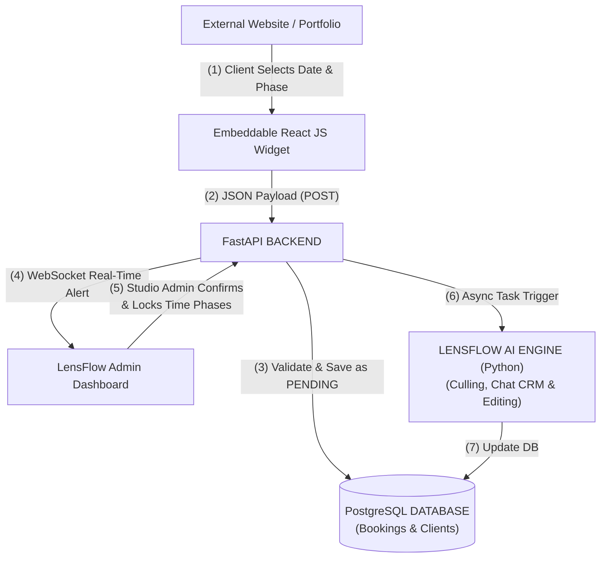
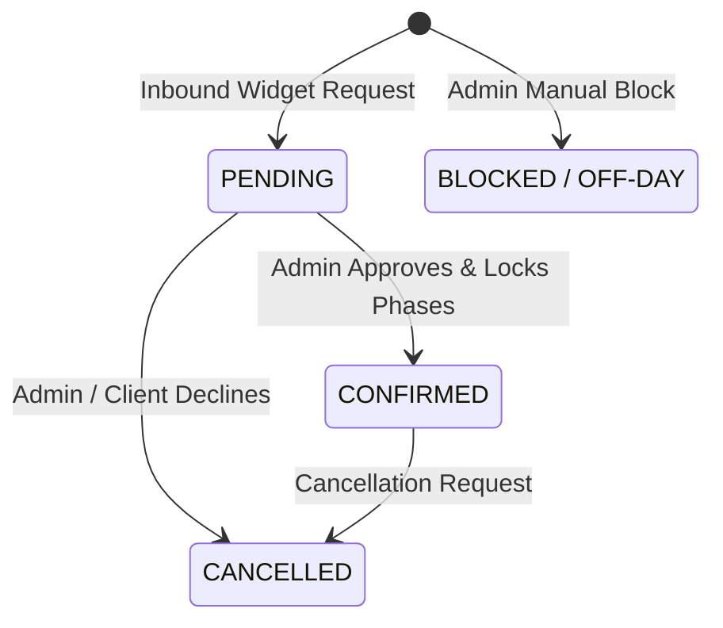

# 📄 LENSFLOW - MASTER PRODUCT REQUIREMENTS DOCUMENT (PRD) v1.2

---

## 1. EXECUTIVE SUMMARY & VISION

**LensFlow** is an AI-powered operating system designed specifically for modern photography studios and freelance photographers. It unifies client booking, studio management, and AI-driven photo processing into a single, seamless **Hub-and-Spoke architecture**. 

The v1.2 MVP focuses heavily on two core differentiators:
1. **Embeddable Time-Phase Booking Widget**: Allows clients to select date and multi-phase time slots directly on any external website.
2. **Behavioral AI Photo Culling & CRM Engine**: Automated grouping, flaw detection, smart rating of high-volume RAW images, and context-aware CRM response drafting.

### Target Users
- **Solo Freelance Photographers**: Need to automate client booking, eliminate administrative churn, and speed up image delivery.
- **High-Volume Event & Wedding Studios**: Manage multiple team members, complex multi-phase event bookings, and thousands of RAW images per event.

---

## 2. SYSTEM ARCHITECTURE (Hub-and-Spoke + AI)

The system operates asynchronously to ensure heavy AI vision processing and background tasks do not block core API web servers.



### Key Architectural Flow
1. **Inbound Booking**: External websites embed the lightweight React widget (Spoke). Client selects dates and phases and submits a payload to FastAPI.
2. **Pending & Locking**: The request is stored in PostgreSQL as `PENDING` without locking the public calendar immediately to avoid malicious spam-locking.
3. **Real-Time Notification & Approval**: Real-time notifications via WebSockets alert the LensFlow Admin Dashboard. Once the studio admin confirms, selected time phases are globally locked.
4. **AI Vision & Editing Pipeline**: An asynchronous background task (e.g. via Celery/Redis) triggers the Python AI engine for RAW photo culling, flaw detection, and style editing.

---

## 3. CORE MODULES & BUSINESS LOGIC

### 3.1 Smart Time-Phase Calendar Architecture
A single operational calendar date is segmented into three distinct time blocks to maximize booking revenue and operational capacity:

| Time Phase | Operational Hours | Example Event Types |
| :--- | :--- | :--- |
| **Phase 1: Morning** | `05:00 AM - 12:00 PM` | Portrait sessions, Graduation Shoots |
| **Phase 2: Afternoon** | `12:00 PM - 05:00 PM` | Commercial Shoots, Pre-wedding sessions |
| **Phase 3: Evening** | `05:00 PM - 12:00 AM` | Wedding Receptions, Night Events |

#### Business Rule
- Phases can be booked **independently** or **combined** (e.g. Afternoon + Evening for a full wedding).
- Once a booking is **CONFIRMED** by the studio admin, the specific phases selected are globally locked and become unavailable on the public widget.

### 3.2 Embeddable Client Widget (The Spoke)
- **Component**: A lightweight, highly performant React component designed to be embedded seamlessly via `<iframe>` or a single script tag (`<script>`).
- **Data Logic**: 
  - Fetches available phases for a selected month dynamically from `GET /api/v1/availability`.
  - Captures client details and desired phase selections.
  - Sends an inline POST payload to `POST /api/v1/bookings/widget` without redirecting the user away from the photographer's portfolio page.

### 3.3 Booking Management Pipeline



* **State 1: PENDING**  
  Inbound widget requests arrive into the admin inbox. The public calendar remains open to prevent malicious users from spam-locking availability.
* **State 2: CONFIRMED**  
  Admin reviews the request, negotiates package details with the client, and clicks **Confirm**. The Admin UI prompts explicit confirmation of phases to lock globally.
* **State 3: BLOCKED / OFF-DAY**  
  Admin can manually block specific phases or the full day (e.g., for gear maintenance, travel, or editing days). This instantly disables those phases on the public client widget.

---

## 4. AI ENGINE SPECIFICATIONS

### 4.1 Smart AI Photo Culling (Behavioral Analysis)
* **Objective**: Replicate human photo culling judgment (similar to Aftershoot) for high-volume shoots containing 2,000+ RAW images.

#### Processing Pipeline
1. **Duplicate Grouping**: Identifies burst shots based on precise EXIF timestamp proximity and visual similarity embeddings.
2. **Flaw Detection**: Flags and isolates bad shots containing:
   - Motion blur & camera shake
   - Out-of-focus or missed focus subjects
   - Closed eyes / accidental blinks
3. **Smart Rating Engine**: Evaluates facial expressions (smiles, open eyes, framing) and assigns metadata ratings (e.g., assigning a 5-star rating to the best shot in a burst group).
4. **Categorized Output Tiers**:
   - **Highlights**: Sneak peeks ready for immediate client preview.
   - **Selected**: Best shots of each group ready for color grading.
   - **Duplicates**: Alternate angles/bursts kept as backup.
   - **Rejects**: Flawed shots (blurs, blinks, bad focus).

### 4.2 AI Assistant (CRM) & Style Editing
* **CRM Assistant**: Parses incoming widget queries and client emails to generate context-aware draft responses with customized pricing and package quotes.
* **AI Style Editing**: Applies trained Lightroom-style color grading profiles uniformly across all culled images to maintain signature brand aesthetics.

---

## 5. DATABASE SCHEMA (PostgreSQL)

### Entity-Relationship Summary

```sql
-- Table: clients
CREATE TABLE clients (
    id UUID PRIMARY KEY DEFAULT gen_random_uuid(),
    full_name VARCHAR(255) NOT NULL,
    email VARCHAR(255) UNIQUE NOT NULL,
    phone VARCHAR(50) NOT NULL,
    created_at TIMESTAMP WITH TIME ZONE DEFAULT CURRENT_TIMESTAMP
);

-- Table: bookings
CREATE TABLE bookings (
    id UUID PRIMARY KEY DEFAULT gen_random_uuid(),
    client_id UUID NOT NULL REFERENCES clients(id) ON DELETE CASCADE,
    booking_date DATE NOT NULL,
    event_type VARCHAR(100) NOT NULL, -- e.g., "Wedding Package", "Graduation"
    is_morning BOOLEAN DEFAULT false,
    is_afternoon BOOLEAN DEFAULT false,
    is_evening BOOLEAN DEFAULT false,
    status VARCHAR(20) DEFAULT 'PENDING' CHECK (status IN ('PENDING', 'CONFIRMED', 'CANCELLED')),
    created_at TIMESTAMP WITH TIME ZONE DEFAULT CURRENT_TIMESTAMP
);

-- Table: calendar_blocks
CREATE TABLE calendar_blocks (
    id UUID PRIMARY KEY DEFAULT gen_random_uuid(),
    block_date DATE NOT NULL,
    is_morning_blocked BOOLEAN DEFAULT false,
    is_afternoon_blocked BOOLEAN DEFAULT false,
    is_evening_blocked BOOLEAN DEFAULT false,
    reason_note VARCHAR(255), -- e.g., "Studio setup for promo"
    created_at TIMESTAMP WITH TIME ZONE DEFAULT CURRENT_TIMESTAMP
);
```

---

## 6. API ENDPOINTS SPECIFICATION (FastAPI)

### 6.1 `GET /api/v1/availability`
* **Query Parameters**: `month=2026-08`
* **Logic**: Queries `bookings` (where `status = 'CONFIRMED'`) and `calendar_blocks`. Combines reserved/blocked slots and returns available time phases for each day of the month.
* **Response Sample**:
```json
{
  "month": "2026-08",
  "days": [
    {
      "date": "2026-08-15",
      "morning": true,
      "afternoon": false,
      "evening": false
    }
  ]
}
```

### 6.2 `POST /api/v1/bookings/widget`
* **Description**: Public endpoint for client booking requests from the embeddable widget.
* **Payload Example**:
```json
{
  "client": {
    "name": "Tharindu",
    "phone": "077xxxxxxx",
    "email": "tharindu@example.com"
  },
  "booking": {
    "date": "2026-08-15",
    "type": "Graduation",
    "phases": ["Morning"]
  }
}
```
* **Logic**: Saves client & booking data with `status = 'PENDING'`, then emits a real-time WebSocket event to the Admin Dashboard.

### 6.3 `PUT /api/v1/bookings/{id}/confirm`
* **Description**: Admin action to confirm booking and lock phases.
* **Payload Example**:
```json
{
  "is_morning": true,
  "is_afternoon": true,
  "is_evening": false
}
```
* **Logic**: Updates booking status to `CONFIRMED` and locks the specified time phases on the calendar.

### 6.4 `POST /api/v1/ai/cull-job`
* **Description**: Triggers asynchronous background culling job.
* **Payload Example**:
```json
{
  "booking_id": "8f3b2a1c-4d5e-6f7a-8b9c-0d1e2f3a4b5c",
  "s3_bucket": "lensflow-raw-storage",
  "s3_prefix": "shoots/2026-08-15-graduation/"
}
```
* **Logic**: Spawns a background task worker (Celery/Redis) to run PyTorch/ONNX vision models on RAW images stored in cloud storage.

---

## 7. RECOMMENDED TECH STACK

| Component | Technology | Purpose / Justification |
| :--- | :--- | :--- |
| **Frontend Dashboard** | **Next.js (React), Tailwind CSS, Framer Motion** | Fast SSR, modern animations, responsive admin UI |
| **Embeddable Widget** | **React / Vanilla JS Bundle** | Lightweight, fast loading, zero external dependencies |
| **Backend API** | **FastAPI (Python)** | High-performance async Python backend, ideal for AI processing |
| **Database** | **PostgreSQL** | Relational integrity for bookings, clients, and time blocks |
| **AI / Vision ML** | **PyTorch, ONNX Runtime, OpenCV** | Local high-speed vision inference for photo culling & face detection |
| **LLM CRM Engine** | **OpenAI / Gemini API** | Context-aware client email drafting and package quoting |
| **Cloud Storage** | **AWS S3 / Cloudflare R2** | Scalable storage for high-volume RAW and rendered photos |
