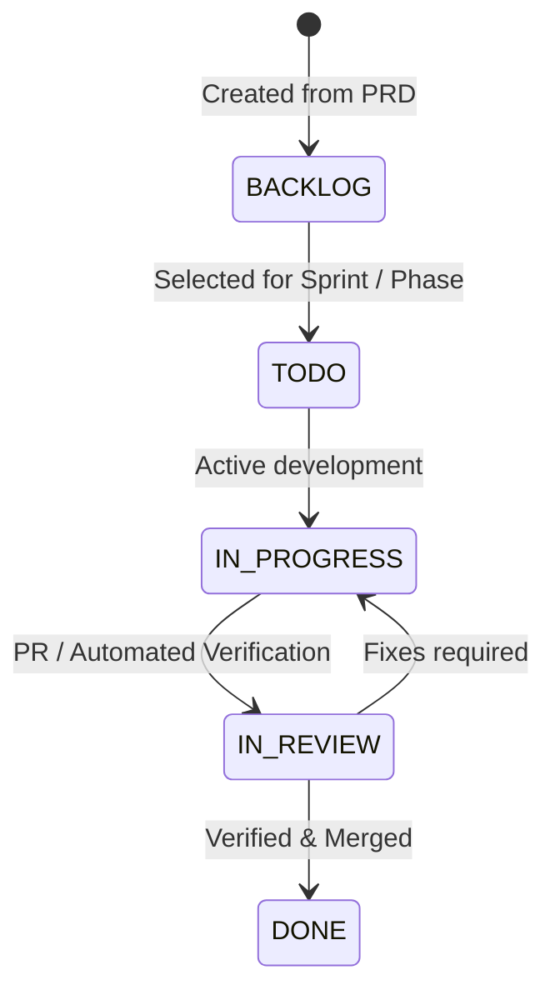

# 🚀 LensFlow Process & Task Management Strategy

---

## 1. Overview & Purpose
This document defines the official **Process Management Strategy & Task Breakdown System** for **LensFlow**. The goal is to provide a clear, repeatable, and maintainable workflow for breaking down high-level Product Requirements (PRD v1.2) into actionable tasks, sub-tasks, and micro-action items.

---

## 2. The 5-Tier Task Hierarchy

To ensure no feature is overwhelming and every block of code has clear context, all work in LensFlow follows a 5-tier taxonomy:

```
Level 1: EPIC (Broad Strategic Goal / Major Subsystem)
  └── Level 2: FEATURE / MODULE (Specific functional capability)
        └── Level 3: TASK (Standalone unit of work / API endpoint / UI view)
              └── Level 4: SUB-TASK (Specific file implementation / function / query)
                    └── Level 5: ACTION ITEM (Micro check-off / line-item work)
```

### Hierarchy Breakdown:

| Level | Name | Description | Example |
| :--- | :--- | :--- | :--- |
| **L1** | **Epic** | Major system boundary or architectural component | `EPIC-001: Backend Core & Database` |
| **L2** | **Feature** | Logical capability addressing a set of Functional Requirements | `FEAT-1.1: Smart Time-Phase Calendar DB & Schema` |
| **L3** | **Task** | A concrete work unit deliverable by one developer in 2–6 hours | `TASK-1.1.1: Create PostgreSQL Schema & Migration for Clients & Bookings` |
| **L4** | **Sub-Task** | Specific implementation step (backend route, schema model, component) | `SUB-1.1.1a: Write SQLAlchemy / SQL models for clients, bookings, calendar_blocks` |
| **L5** | **Action Item** | Granular execution check (e.g. unit test, error handling, validation) | `ACT-1: Add regex validation for phone & email fields` |

---

## 3. Standard Task Template

Every task added to the project management system should follow this standardized format to maintain consistency and traceability:

```markdown
### [TASK-ID] Title of Task
- **Epic**: EPIC-XXX
- **Feature**: FEAT-X.X
- **Requirement Mapping**: FR-XXX, NFR-XXX
- **Status**: [ ] BACKLOG | [/] IN_PROGRESS | [x] COMPLETED
- **Priority**: HIGH | MEDIUM | LOW
- **Estimated Time**: X hours
- **Dependencies**: [TASK-ID]

#### Description
Brief context of what needs to be built and why.

#### Sub-Tasks & Action Items
- [ ] **SUB-1**: [Sub-task title]
  - [ ] ACT-1: Detail step 1
  - [ ] ACT-2: Detail step 2
- [ ] **SUB-2**: [Sub-task title]
  - [ ] ACT-1: Detail step 1

#### Acceptance Criteria
- [ ] Criteria 1 (e.g., Endpoint returns 200 OK with valid payload)
- [ ] Criteria 2 (e.g., Migration passes without errors)
```

---

## 4. Task Lifecycle & Kanban Workflow

Tasks move through 5 strict status states:



1. **BACKLOG**: Unscheduled tasks from PRD/Roadmap.
2. **TODO**: Planned for current phase; ready to start.
3. **IN_PROGRESS**: Currently being implemented (marked as `[/]`).
4. **IN_REVIEW**: Code written, currently running tests / code review.
5. **DONE**: Verified against Acceptance Criteria and checked off (`[x]`).

---

## 5. Maintenance Standard Operating Procedure (SOP)

To keep the project organized and prevent task drift:

### Daily Workflow
1. **Pick One Task**: Focus exclusively on ONE task at a time from `master_task_tree.md`.
2. **Mark Status**: Change task status to `[/] IN_PROGRESS`.
3. **Execute Sub-Tasks**: Work through L4 Sub-Tasks and L5 Action Items sequentially.
4. **Verify**: Test changes against the defined Acceptance Criteria.
5. **Close & Commit**: Mark as `[x] COMPLETED`, document changes in git/changelog, and move to the next item.

### AI Pair-Programming Integration
When working with your AI Coding Assistant (Antigravity):
- Point to the specific Task ID (e.g., *"Let's complete TASK-1.1.1"*).
- The AI will inspect PRD requirements, update `task.md`, execute sub-tasks, run tests, and check off completed items cleanly.

---

## 6. Project Document Structure

Keep documentation organized in the repository under `/project-management/`:

```
d:\Development\Lens Flow\
├── docs/
│   └── PRD_v1.2.md                         <-- Master Product Requirements Document
└── project-management/
    ├── PROCESS_MANAGEMENT_STRATEGY.md      <-- This Strategy Document
    ├── tasks/
    │   └── master_task_tree.md             <-- Live Master Task & Sub-task Breakdown
    ├── roadmap/
    │   └── phases.md                       <-- High-Level Release Phases
    └── traceability/
        └── requirements.md                 <-- Requirements Traceability Matrix
```
