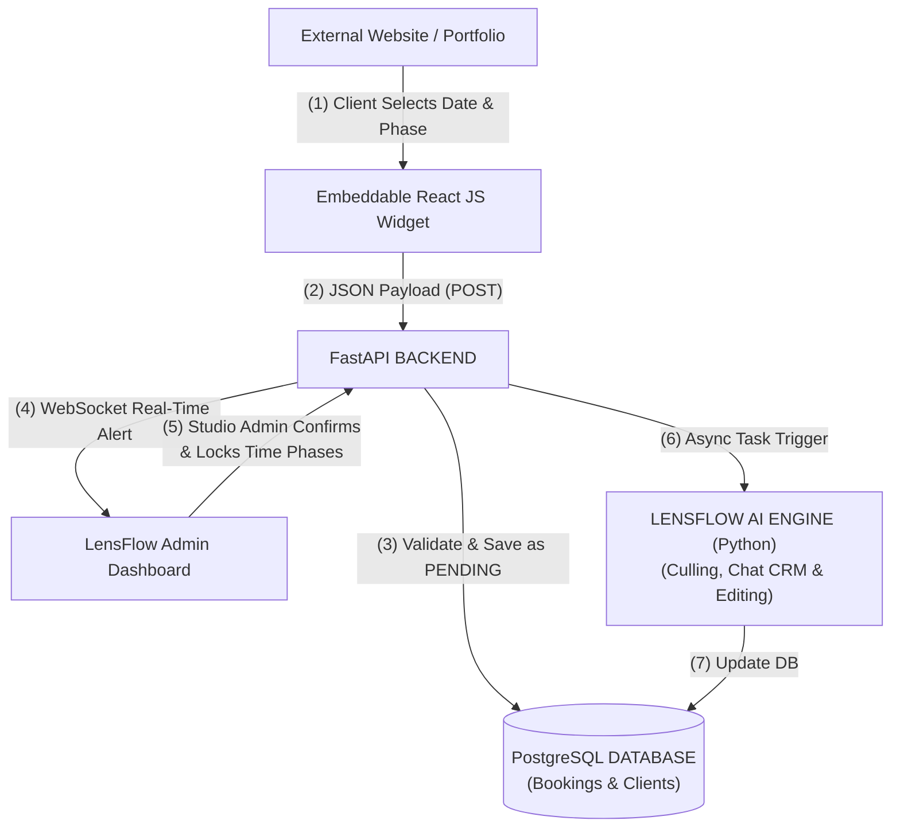

# System Architecture Design (LensFlow v1.2)

## 1. High-Level Architecture (Hub-and-Spoke + AI)

LensFlow operates on an asynchronous Hub-and-Spoke architecture designed to prevent heavy AI processing from blocking main API web servers.

## 2. Frontend Architecture
- **Admin Dashboard**: Next.js (React), TypeScript, Tailwind CSS, Framer Motion
- **Embeddable Widget (The Spoke)**: Lightweight React / Vanilla JS bundle embeddable via `<iframe>` or `<script>` tag.
- **State & Real-time**: React Context / Zustand + WebSockets for real-time booking alerts.

## 3. Backend Architecture
- **Framework**: FastAPI (Python)
- **Pattern**: Modular Async Architecture (Routes - Services - Repositories)
- **Task Queue**: Celery / Redis for handling background AI culling & raw photo processing.
- **Real-Time Engine**: WebSocket Manager for live admin alerts.

## 4. AI Engine Specifications
- **Vision Models**: PyTorch & ONNX Runtime for local high-speed duplicate grouping, flaw detection, and smart rating.
- **LLM Integration**: Gemini / OpenAI APIs for automated CRM email drafting and quote generation.
- **Color Grading**: Custom style profiles for uniform batch editing.

## 5. Storage System
- **Provider**: AWS S3 or Cloudflare R2 for scalable RAW image storage.
- **Security**: Pre-signed URLs for private client galleries.

## 6. Security & Authentication
- JWT Authentication for studio admins & team members.
- Input validation (Pydantic / FastAPI).
- CORS configuration for widget embeds.

