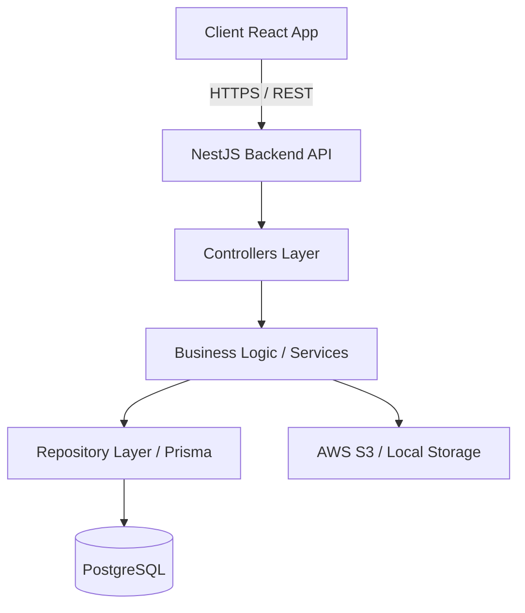

# System Architecture Design

## 1. High-Level Architecture
LensFlow follows a Backend-Centric, layered architecture pattern.

## 2. Frontend Architecture
- **Framework**: React with TypeScript
- **Styling**: Tailwind CSS
- **Routing**: React Router
- **State Management**: React Context / Zustand (TBD)
- **Data Fetching**: Axios / React Query

## 3. Backend Architecture
- **Framework**: NestJS
- **Language**: TypeScript
- **Pattern**: Modular, Layered Architecture (Controller-Service-Repository)
- **Authentication**: JWT Strategy (Access & Refresh tokens)
- **Authorization**: Role-Based Access Control (RBAC) via NestJS Guards

## 4. File Storage System
- **Development**: Local Storage (Multer)
- **Production**: AWS S3 compatible object storage
- **Security**: Pre-signed URLs for private galleries, password-protected album access

## 5. Security & Authentication System
- **Auth Protocol**: JWT
- **Password Security**: bcrypt hashing
- **Data Protection**: HTTPS, Input validation (class-validator), Rate Limiting

## 6. Notification System (Future proofing)
- Event-driven architecture using NestJS Event Emitter
- Email notifications (SendGrid/AWS SES)
- In-app database notifications

## 7. AI Modules (Placeholders)
- Image optimization service hook
- AI photo culling webhooks
- Face recognition processing queue (RabbitMQ/Redis)
